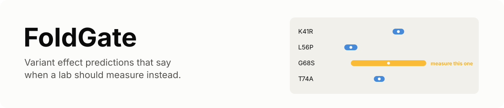

<picture>
  <source media="(prefers-color-scheme: dark)" srcset="docs/assets/banner-dark.svg">
  
</picture>

[](https://github.com/Sanika0212/FoldGate/actions/workflows/ci.yml)


**FoldGate predicts how much a single amino-acid substitution changes a protein's function,
and puts an interval around every prediction honest enough that a lab can use it to decide
which variants to put on the bench.**

A protein-language model will score any variant you hand it, including ones nothing like
what it learned from, and the score looks the same either way. A lab with bench time for
twenty variants out of two thousand cannot use a number that does not know its own error.
So the model here ships with three things a bare score does not have: a conformal interval
whose coverage is measured, an abstention rule for the variants it should not be trusted
on, and a release gate that refuses to promote a model whose intervals flatter it.

ACCURACY_SECTION

CALIBRATION_SECTION

SHIFT_SECTION

GATE_SECTION

SERVING_SECTION

## How it works

```
ProteinGym DMS assays, 12 proteins, 30,757 single substitutions
        |
        v
  zero-shot wild-type marginal from ESM-2 (no labels)
        |
        v
  LoRA on query and value + a head on the mutated position     (train split)
        |
        v
  conformal calibration, difficulty model, abstention width    (calibration split)
        |
        v
  release gate: better than zero-shot, honest coverage, inside the SLO
        |                                        |
     rejected, with reasons                   champion
                                                 |
                                                 v
  ONNX export (LoRA merged) -> router: intervals, abstention, A/B, shadow, batching
```

[Architecture](docs/architecture.md) explains each stage and why the splits are what they
are; [the runbook](docs/runbook.md) covers running it and what to do when something drifts.

## Honest notes

1. **Public data, nothing private.** Twelve ProteinGym deep mutational scanning assays,
   downloaded from the Hugging Face Hub. No lab's unpublished measurements are involved,
   and no claim here is about a real screening programme.
2. **A small backbone.** ESM-2 35M with LoRA on the query and value projections, chosen so
   the whole experiment runs on one laptop GPU. A 650M backbone would rank better; what
   this project is about is everything around the model, not the ranking.
3. **What ran and what did not.** Training, calibration, the shift test, the ONNX export
   and the load test all ran and wrote the files in `runs/`. The Helm chart and the KServe
   InferenceService are rendered and schema checked in CI but were never applied to a
   cluster. The SageMaker stack is validated and linted in CI and has never been applied to
   an AWS account: no endpoint, no bill, and no cost figure anywhere in this repository.
4. **Latency is one machine.** The serving numbers come from the router driven in-process
   on CPU, not from a cluster under production traffic. They are a floor for the batching
   comparison, not a capacity plan.
5. **Conformal guarantees are conditional.** Coverage holds when test variants are
   exchangeable with the calibration ones. The shift section is this project showing where
   that assumption breaks and what it costs to repair.

## Run it

```bash
uv sync --all-extras
make data                      # ProteinGym shards, then the zero-shot cache
make eval                      # baselines, training, shift, serving, gate
make figures
make serve                     # the champion on :8080
```

Serving a version needs only ONNX Runtime; training needs torch. The zero-shot cache in
`data/zero_shot.parquet` is committed, so the baselines reproduce without the weights.

## What I would do next

1. Swap in the 650M backbone and see how much of the gap to the supervised ceiling closes,
   and whether the interval widths shrink with it.
2. Calibrate per protein family rather than pooled, so abstention reflects which family a
   variant belongs to.
3. Learn the abstention threshold from a lab's real cost of a wasted assay instead of
   fixing it at a quantile of interval width.
4. Serve through Triton with the ONNX backend and compare its dynamic batching with the
   router's own.

## License

Apache 2.0. See [LICENSE](LICENSE) and [NOTICE](NOTICE).
