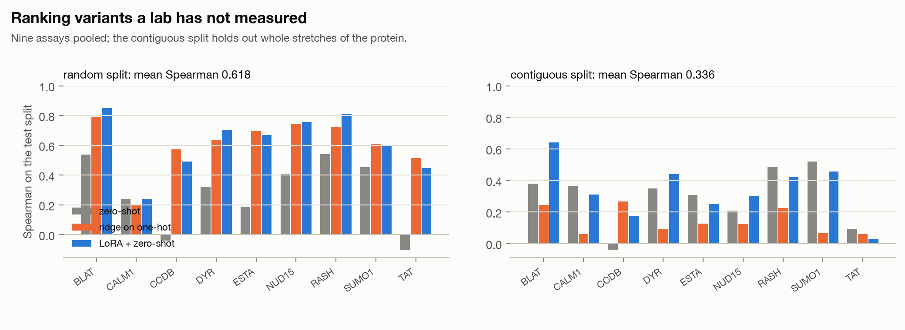
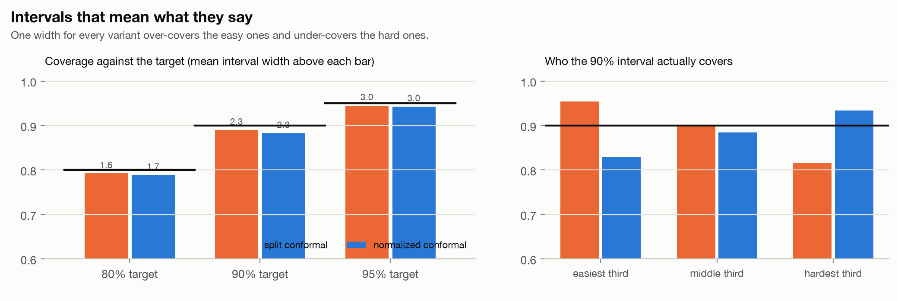
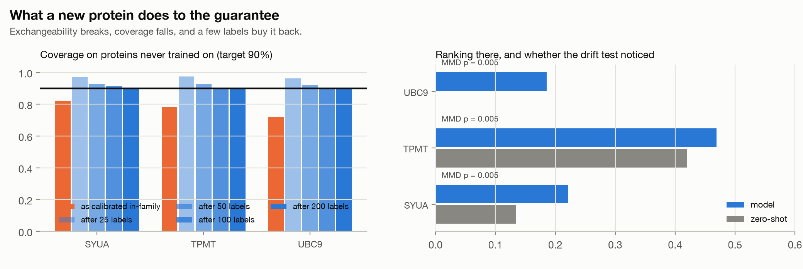
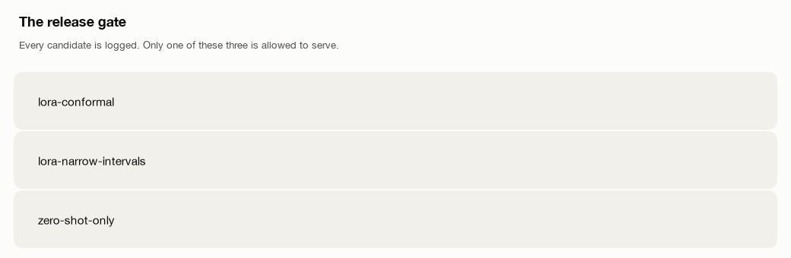
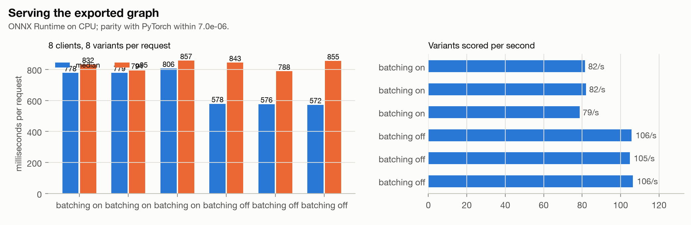

<picture>
  <source media="(prefers-color-scheme: dark)" srcset="docs/assets/banner-dark.svg">
  
</picture>

[](https://github.com/Sanika0212/FoldGate/actions/workflows/ci.yml)


**FoldGate predicts how much a single amino-acid substitution changes a protein's function,
and puts an interval around every prediction honest enough that a lab can use it to decide
which variants to put on the bench.**

A protein-language model will score any variant you hand it, including ones nothing like
what it learned from, and the score looks the same either way. A lab with bench time for
twenty variants out of two thousand cannot use a number that does not know its own error.
So the model here ships with three things a bare score does not have: a conformal interval
whose coverage is measured, an abstention rule for the variants it should not be trusted
on, and a release gate that refuses to promote a model whose intervals flatter it.

<!-- ACCURACY:start -->
## Accuracy

Nine pooled assays, 13,296 training variants, 4,541 held out for test. LoRA trains 0.73% of the weights.

| assay | variants | Spearman | NDCG of the top decile |
| --- | --- | --- | --- |
| BLAT_ECOLX_Firnberg_2014 | 980 | 0.851 | 0.824 |
| RASH_HUMAN_Bandaru_2017 | 632 | 0.810 | 0.883 |
| NUD15_HUMAN_Suiter_2020 | 577 | 0.757 | 0.844 |
| DYR_ECOLI_Thompson_2019 | 479 | 0.702 | 0.928 |
| ESTA_BACSU_Nutschel_2020 | 442 | 0.670 | 0.880 |
| SUMO1_HUMAN_Weile_2017 | 361 | 0.598 | 0.765 |
| CCDB_ECOLI_Tripathi_2016 | 353 | 0.492 | 0.972 |
| TAT_HV1BR_Fernandes_2016 | 334 | 0.446 | 0.750 |
| CALM1_HUMAN_Weile_2017 | 383 | 0.239 | 0.812 |
| **mean** | | **0.618** | **0.851** |

Against the baselines, by mean Spearman across assays:

| baseline | Spearman | difference against this model |
| --- | --- | --- |
| ridge_one_hot_plus_zero_shot | 0.655 | -0.037 |
| ridge_one_hot | 0.610 | +0.008 |
| zero_shot | 0.283 | +0.335 |

The strongest baseline, ridge_one_hot_plus_zero_shot, is not beaten here: 0.655 against 0.618. A ridge regression on one-hot mutations plus the zero-shot score is cheaper to fit than this model and scores better on these assays, so nothing here argues for the trained model on accuracy alone. What it adds is the calibrated interval, which the baseline does not have.

The release gate does not catch this, and that is worth naming: its accuracy criterion is only that the model beat zero-shot, which it does by a wide margin. A gate that compared against the best available baseline would reject this candidate. The one built here promotes it.

<picture>
  <source media="(prefers-color-scheme: dark)" srcset="docs/assets/accuracy-dark.png">
  
</picture>

<!-- ACCURACY:end -->

<!-- CALIBRATION:start -->
## Do the intervals mean what they say

Coverage is measured on the test split, with the conformal quantile taken from the
calibration split. A narrower interval is only better if it still covers, so the
width is reported beside it.

| target | split conformal | width | normalized | width |
| --- | --- | --- | --- | --- |
| 95% | 0.945 | 2.98 | 0.943 | 3.01 |
| 90% | 0.890 | 2.28 | 0.883 | 2.29 |
| 80% | 0.792 | 1.61 | 0.788 | 1.67 |

A plain conformal interval is one width for every variant, so it over-covers the easy
ones and under-covers the hard ones. Coverage inside each third of the variants,
ordered by predicted difficulty, at the 90% target:

| difficulty | split conformal | normalized |
| --- | --- | --- |
| easiest third | 0.954 | 0.829 |
| middle third | 0.900 | 0.885 |
| hardest third | 0.816 | 0.934 |

The largest gap between target and achieved coverage is 0.017, by the normalized scheme at the 90% target.

### The same method on a split that breaks the assumption

Coverage above is measured on the random split, where a variant's position is as likely to land in calibration as in test, which is what exchangeability asks for. The contiguous split holds out whole stretches of the protein, so the calibration variants and the test variants come from different regions and the assumption fails. Nothing else changes: same backbone, same rank, same epochs, same conformal method.

| target | random split | contiguous split | miss |
| --- | --- | --- | --- |
| 95% | 0.945 | 0.904 | -0.046 |
| 90% | 0.890 | 0.834 | -0.066 |
| 80% | 0.792 | 0.692 | -0.108 |

The promise misses by as much as 0.108 there, against the 0.02 the release gate allows, so the gate rejects that model on coverage and is right to. Accuracy falls too, mean Spearman 0.336 against 0.618, which is the easier half of the finding: a harder split is harder. The interval is the part worth looking at, because it was still reporting the same nominal confidence while covering far less than it claimed.

<picture>
  <source media="(prefers-color-scheme: dark)" srcset="docs/assets/calibration-dark.png">
  
</picture>

<!-- CALIBRATION:end -->

<!-- SHIFT:start -->
## What happens on a protein it never saw

Conformal coverage holds only while test variants are exchangeable with the
calibration ones. A protein from a family the model never trained on breaks that.
Three were held out for exactly this measurement.

| assay | variants | Spearman | zero-shot | coverage | after 200 labels | MMD p |
| --- | --- | --- | --- | --- | --- | --- |
| SYUA_HUMAN_Newberry_2020 | 2,497 | 0.222 | 0.134 | 0.824 | 0.903 | 0.00498 |
| TPMT_HUMAN_Matreyek_2018 | 3,648 | 0.469 | 0.419 | 0.783 | 0.898 | 0.00498 |
| UBC9_HUMAN_Weile_2017 | 2,563 | 0.186 | -0.000 | 0.718 | 0.905 | 0.00498 |

The target is 90%. Labelling 200 variants of the new protein and
recomputing the quantile is what restores it, and the MMD p-value says the shift is
detectable before any label arrives.

<picture>
  <source media="(prefers-color-scheme: dark)" srcset="docs/assets/shift-dark.png">
  
</picture>

<!-- SHIFT:end -->

<!-- GATE:start -->
## The release gate

A candidate is promoted only when it beats zero-shot on accuracy, covers within two
points of its target, and keeps p95 latency under 3000 ms. Three
candidates are put through it, two of which should fail.

| candidate | Spearman | coverage | p95 ms | verdict |
| --- | --- | --- | --- | --- |
| lora-conformal | 0.618 | 0.883 | 832 | promoted |
| lora-narrow-intervals | 0.618 | 0.680 | 832 | rejected |
| zero-shot-only | 0.283 | 0.898 | 832 | rejected |

Why each rejection was rejected:

1. **lora-narrow-intervals**: coverage 0.680 is outside 0.90 +/- 0.02
2. **zero-shot-only**: Spearman 0.283 does not beat zero-shot 0.283

<picture>
  <source media="(prefers-color-scheme: dark)" srcset="docs/assets/gate-dark.gif">
  
</picture>

<!-- GATE:end -->

<!-- SERVING:start -->
## Serving

ONNX export with LoRA merged, checked against PyTorch: largest absolute difference
6.97e-06, against a tolerance of 0.001.

The router is driven in-process through ASGI with 8 concurrent
clients sending 8 variants per request. Latency is a
property of that workload, not of the model alone. Every figure below is the median
of 3 warm runs, with the spread beside it,
because a single run of this on a laptop moves by more than a factor of two.

| batching | median ms | p95 ms | p95 spread | variants per second |
| --- | --- | --- | --- | --- |
| off | 576.2 | 843.5 | 788 to 855 | 106 |
| on | 779.1 | 832.1 | 794 to 857 | 82 |

The two p95 figures cannot be told apart at this sample size: 832 ms against 843 ms, with ranges of 794 to 857 and 788 to 855 that overlap along their whole length. Reporting a ratio of the medians would be reporting noise. What does separate is the rest of the distribution: median latency 779 ms batched against 576 ms unbatched, and throughput 82 against 106 variants per second. Batching costs 1.3 times the throughput here and buys nothing at the tail. The reason is the device: these graphs run on CPU, where one request for eight variants already uses every core. Gathering eight of them into one pass replaces eight parallel scorings with a single sequential one and adds the batching window on top. Dynamic batching pays off where a single request leaves the accelerator idle, which is true of a GPU and is not true here. It is left in the router, off by default in the serve command, which is the deployment these numbers came from, and available behind --batching for hardware where it pays.

The A/B split sent 12% of experiments to the candidate against a configured 20%, which is what hashing a few dozen experiment names gives: the assignment is stable per experiment rather than balanced per request, so a small number of experiments does not land on the nominal share. Shadow scoring stayed off the response path at a median of 1404.5 ms with 48 comparisons logged.

<picture>
  <source media="(prefers-color-scheme: dark)" srcset="docs/assets/serving-dark.png">
  
</picture>

<!-- SERVING:end -->

## How it works

```
ProteinGym DMS assays, 12 proteins, 30,757 single substitutions
        |
        v
  zero-shot wild-type marginal from ESM-2 (no labels)
        |
        v
  LoRA on query and value + a head on the mutated position     (train split)
        |
        v
  conformal calibration, difficulty model, abstention width    (calibration split)
        |
        v
  release gate: better than zero-shot, honest coverage, inside the SLO
        |                                        |
     rejected, with reasons                   champion
                                                 |
                                                 v
  ONNX export (LoRA merged) -> router: intervals, abstention, A/B, shadow, batching
```

[Architecture](docs/architecture.md) explains each stage and why the splits are what they
are; [the runbook](docs/runbook.md) covers running it and what to do when something drifts.

## Honest notes

1. **Public data, nothing private.** Twelve ProteinGym deep mutational scanning assays,
   downloaded from the Hugging Face Hub. No lab's unpublished measurements are involved,
   and no claim here is about a real screening programme.
2. **A small backbone.** ESM-2 35M with LoRA on the query and value projections, chosen so
   the whole experiment runs on one laptop GPU. A 650M backbone would rank better; what
   this project is about is everything around the model, not the ranking.
3. **What ran and what did not.** Training, calibration, the shift test, the ONNX export
   and the load test all ran and wrote the files in `runs/`. The Helm chart and the KServe
   InferenceService are rendered and schema checked in CI but were never applied to a
   cluster. The SageMaker stack is validated and linted in CI and has never been applied to
   an AWS account: no endpoint, no bill, and no cost figure anywhere in this repository.
4. **Latency is one machine.** The serving numbers come from the router driven in-process
   on CPU, not from a cluster under production traffic. They are a floor for the batching
   comparison, not a capacity plan.
5. **Conformal guarantees are conditional.** Coverage holds when test variants are
   exchangeable with the calibration ones. The shift section is this project showing where
   that assumption breaks and what it costs to repair.

## Run it

```bash
uv sync --all-extras
make data                      # ProteinGym shards, then the zero-shot cache
make eval                      # baselines, training, shift, serving, gate
make figures
make serve                     # the champion on :8080
```

Serving a version needs only ONNX Runtime; training needs torch. The zero-shot cache in
`data/zero_shot.parquet` is committed, so the baselines reproduce without the weights.

## What I would do next

1. Swap in the 650M backbone and see how much of the gap to the supervised ceiling closes,
   and whether the interval widths shrink with it.
2. Calibrate per protein family rather than pooled, so abstention reflects which family a
   variant belongs to.
3. Learn the abstention threshold from a lab's real cost of a wasted assay instead of
   fixing it at a quantile of interval width.
4. Serve through Triton with the ONNX backend and compare its dynamic batching with the
   router's own.

## License

Apache 2.0. See [LICENSE](LICENSE) and [NOTICE](NOTICE).
